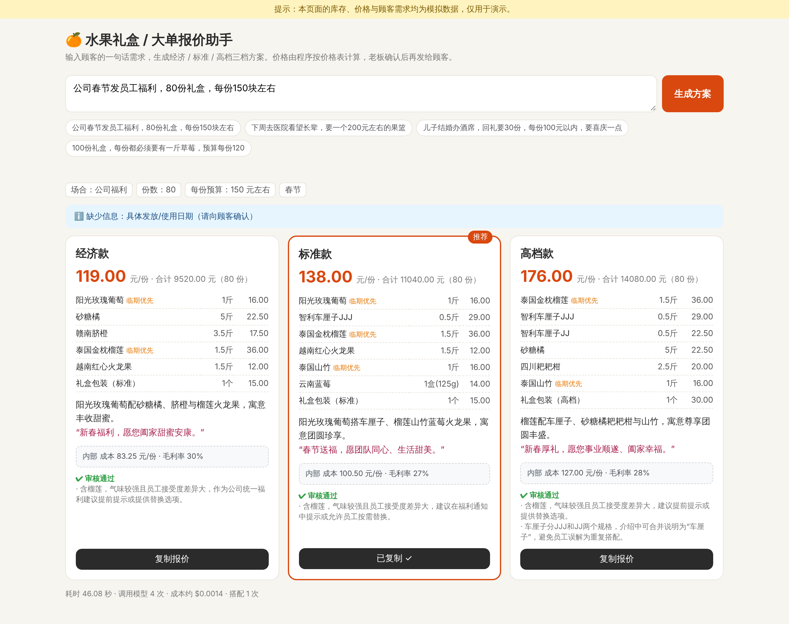
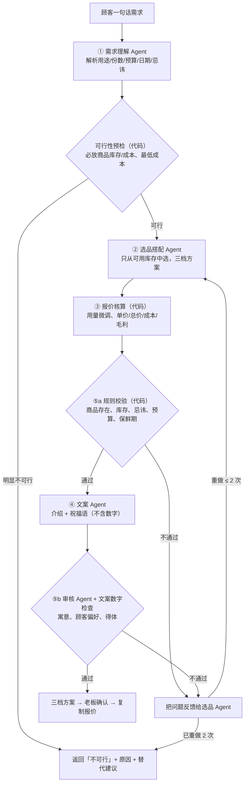
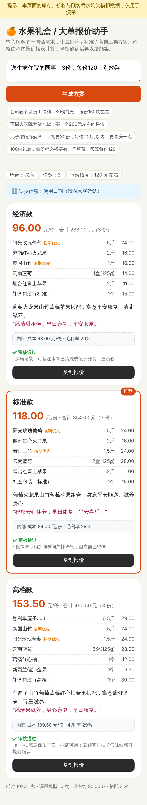
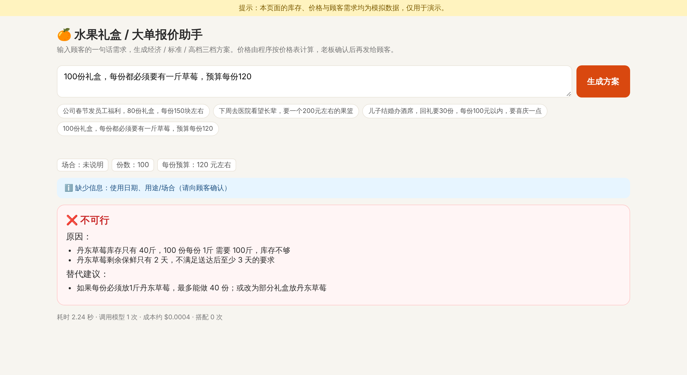

# fruit-gift-quote · 水果礼盒 / 大单报价助手

**一句话介绍**：输入顾客的一句话需求（如"公司春节发 80 份礼盒，每份 150 左右"），多个 AI Agent 协作生成**经济 / 标准 / 高档三档礼盒方案**，价格、成本、毛利全部由代码按价格表计算，并经过规则 + AI 双重审核，老板确认后一键复制发给顾客。

> ⚠️ 项目中的库存、价格和顾客需求均为**参照真实情况编写的模拟数据**；访谈洞察来自真实经营者。



## 为什么做

项目原型来自上海一家水果批发市场里的零售 + 批发档口（家庭经营）。访谈中的关键发现（详见 [PRD.md](PRD.md) 第 1 节）：

- **利润被挤压**：网购、外卖和商超让价格越来越透明，日常零售顾客在流失，周边还有十几家同行。
- **线下优势在大单和送礼**：办酒席、送礼、公司福利的顾客仍愿意到线下亲眼挑货，逢年过节批发占比更高。
- **报价靠人脑和纸笔**：每月价格不同，靠纸笔计算器，出现过记错价、按错计算器的情况。
- **顾客爱讨价还价**，搭配礼盒全凭经验、现场来回调整。
- **易腐水果有损耗**：部分水果放不住，卖不掉就坏。

所以 AI 不去和网店拼价格，而是帮档口**把守得住的大单 / 送礼生意做得更快、更准、更赚钱**。

## 功能

- 一句话需求 → 结构化解析（用途、份数、每份预算、日期、忌讳、缺失信息）
- 只用当日库存搭配**三档方案**，优先使用库存多、快放不住的水果（卡片上标"临期优先"）
- 代码计算单份价格（批发价）、总价、成本、毛利率；毛利率低于 20% 报警
- 每档自动生成方案介绍和祝福语（禁止出现任何数字和价格）
- 程序规则校验 + 审核 Agent 寓意检查，不通过自动打回重做（最多 2 次），仍不行就如实说明「不可行」并给替代建议
- 网页：三档卡片并排（手机上竖排）、毛利率标注「内部」只给店主看、「复制报价」只复制不含成本和毛利的文本
- 评测脚本：20 条测试需求批量跑，输出 PRD 第 7 节全部指标

## 多 Agent 流程



用 LangGraph 编排，代码见 [`app/graph.py`](app/graph.py)。

### 为什么用多 Agent，为什么计算交给代码

- **职责单一、可单独检查**：每一步的输入输出都记录在 `trace` 里，出错能定位到具体环节（解析错了？搭配错了？文案写了数字？）。
- **审核节点能拦截错误**：方案到达顾客前，先过程序规则，再过 AI 寓意审核，不通过自动返工。
- **算数交给代码**：大模型做算术不可靠，而报价出错的代价很高。模型只负责"选什么、选多少"，价格、总价、成本、毛利全部由 [`app/pricing.py`](app/pricing.py) 按价格表计算；模型估价不准时，由代码在已选商品内按半斤/一个的步长**微调用量**，让单份价格落入目标区间（不换品，换品仍由 Agent 决定）。
- **规则写死在代码里**：忌讳表、档位定价、保鲜期门槛、礼盒最低配置都在 [`app/rules.py`](app/rules.py)，不只依赖模型判断。

## 评测结果

在 20 条测试需求上运行 `eval/run_eval.py` 的结果（完整明细见 [eval/results.md](eval/results.md)）：

| 指标 | 结果 | 目标 |
| --- | --- | --- |
| 报价计算准确率 | 100%（51/51） | 100% |
| 预算符合率 | 100%（17/17） | ≥ 90% |
| 库存可行率 | 100%（51/51） | 100% |
| 忌讳违规数 | 0 | 0 |
| 不可行需求识别率 | 100%（3/3） | ≥ 90% |
| 可行需求误判为不可行 | 0 | 记录 |
| 临期水果占比（≤5 天，按重量） | 32.6% | 记录 |
| 需求解析准确率（份数+预算） | 100%（20/20） | 记录 |
| 平均生成耗时 | 34.5 秒 | 记录 |
| 平均单次成本 | $0.0027 | 记录 |
| 平均搭配次数 | 1.00 | 记录 |

说明：报价准确率、库存可行率按"方案档位"统计（每条可行需求 3 档）；评测脚本独立按价格表重算价格，不复用业务代码。跑完 20 条约 $0.05。模型输出有随机性，多次运行结果会有小幅波动。

## 本地运行

需要 Python 3.10+ 和一个 [OpenRouter](https://openrouter.ai) API 密钥。

```bash
pip install -r requirements.txt
```

```bash
cp .env.example .env   # 然后在 .env 里填入 OPENROUTER_API_KEY
```

```bash
uvicorn app.main:app --port 8000
```

浏览器打开 http://localhost:8000 。运行评测：

```bash
python eval/run_eval.py --workers 4
```

环境变量：

| 变量 | 说明 | 默认 |
| --- | --- | --- |
| `OPENROUTER_API_KEY` | OpenRouter 密钥（**只放环境变量 / .env，不要提交**） | 无 |
| `OPENROUTER_MODEL` | 模型名 | `deepseek/deepseek-v4.1-flash-1017` |
| `MAX_COST_USD` | 单个进程累计调用费用上限，超过即拒绝调用 | `0.5` |

**默认模型**：`deepseek/deepseek-v4.1-flash-1017`（DeepSeek V4.1 Flash 的 2026-10-17 固定快照）。选它的原因：中文理解和写作好、支持 JSON 输出、在 OpenRouter 上价格很低（实测约输入 $0.10 / 输出 $0.50 每百万 token），每条需求平均不到 $0.003；用固定快照而不是"最新版"，评测结果更可复现。

## 数据说明

- [`data/inventory.csv`](data/inventory.csv)：29 种水果 + 2 种包装，含成本价、批发价、零售价、库存、剩余保鲜天数、是否适合送礼、寓意。**模拟数据**。
- [`data/test_cases.json`](data/test_cases.json)：20 条测试需求及期望结果（份数、预算、场合、是否可行、必须排除的商品）。**模拟数据**。
- 报价按**批发价**计算，成本按成本价计算；按个/盒卖的商品在统计临期占比时按估算重量折算。

## 产品决策

| 决策 | 做法 | 原因 |
| --- | --- | --- |
| 三档而不是一个价 | 经济 0.8× / 标准 1.0× / 高档 1.3× 预算 | 让顾客"选方案"而不是"砍单价"，高档给往上加一点的选项 |
| 预算措辞 | 说"左右"按 ±10%；说"以内/不超过"时标准款不超预算（90%–100%） | 尊重顾客的上限 |
| 没给预算 | 标注"缺少预算"，按 100 / 200 / 300 元出三档，优先搭配库存久、需尽快卖掉的水果；顾客明显要高档时推荐高档款 | 先给方案再确认，比只追问更快成交 |
| 保鲜期 | 剩余保鲜 ≥ 距使用日天数 + 2 天；没说日期按 1 天内送达，即 ≥ 3 天 | 送到后至少还能放两天 |
| 包装 | 经济、标准用标准礼盒（15 元），高档用高档礼盒（30 元），计入单份价格 | 档次感 |
| 礼盒最低配置 | 至少 2 种水果、合计至少 3 斤 | 太少不像礼盒；也用来判断"预算过低" |
| 忌讳 | 探病、婚庆、乔迁不用梨（F13）；顾客点名不要的不用；"梨"不误伤"凤梨" | 规则表 + 代码核对，不只靠模型 |
| 健康相关需求 | 尽量避开高糖水果，并提示"仅供参考，不构成医疗建议" | 不做医疗建议 |
| 毛利率 | 只给店主看（标注"内部"），复制给顾客的文本不含成本和毛利；低于 20% 报警 | 保护利润底线 |
| 人工确认 | AI 不直接对外报价，老板确认后复制发送 | 报价出错代价高 |

## 迭代计划

PRD 第 9 节：

| 优先级 | 计划 |
| --- | --- |
| P1 | 拍照识别今日到货，自动更新库存 |
| P1 | 生成可发朋友圈的方案图片 |
| P2 | 记录每次报价与成交结果，统计成交率和客单价 |
| P2 | 根据历史成交和保鲜期给出进货建议 |
| P3 | 对接微信，顾客直接从朋友圈进入下单 |

本版本已知不足 / 后续优化：

- **速度**：平均 30+ 秒，大单（如 80 份）或返工时可达 1–2 分钟。可改为流式返回各节点进度，或让三档并行搭配。
- **多档共享库存**：目前每档单独校验库存（顾客只会选一档），未考虑同时有多笔订单占用库存。
- **搭配口味**：模型偶尔会在公司福利中放榴莲这类争议水果（审核 Agent 会给出提示但不拦截），可加入"大众接受度"规则。
- **按个/盒卖的商品重量为估算值**，临期占比只作参考。
- **库存与价格需手动改 CSV**；后续接入每日到货更新（见 P1）。

## 截图

| 公司福利 80 份（桌面） | 探病 3 份（手机） | 不可行：草莓库存不足 |
| --- | --- | --- |
|  |  |  |

## 项目结构

```
app/
  main.py        FastAPI 服务（网页 + /api/quote）
  graph.py       LangGraph 多 Agent 编排
  agents.py      四个 LLM Agent 的提示词
  pricing.py     报价核算（纯代码）
  checks.py      可用商品筛选、不可行预检、用量微调、规则校验
  rules.py       忌讳表、档位、保鲜期等业务规则
  llm.py         OpenRouter 调用、token/费用统计、费用上限
  inventory.py   库存表读取
static/index.html  单页网页
eval/run_eval.py   评测脚本；eval/results.md 评测结果
data/              模拟数据
docs/              网页截图
```
