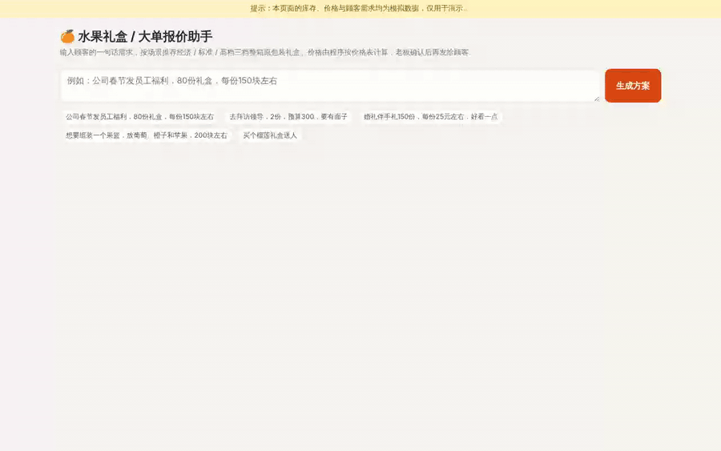
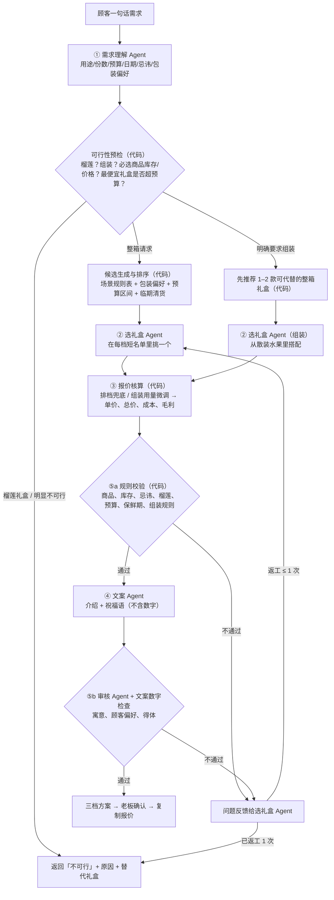
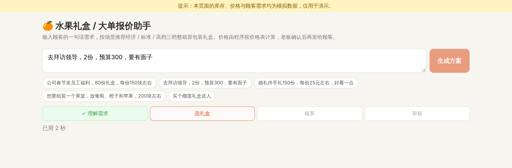
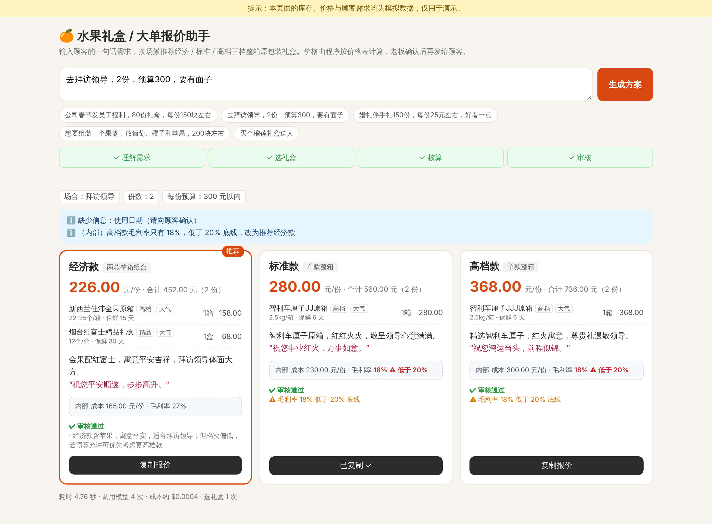
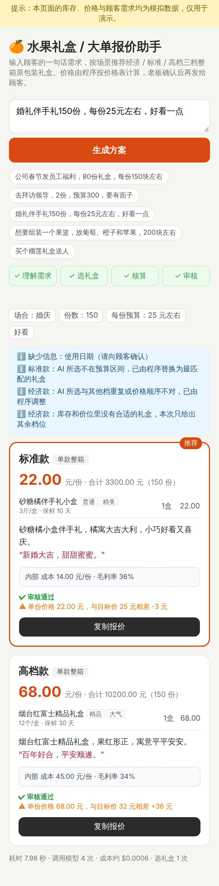
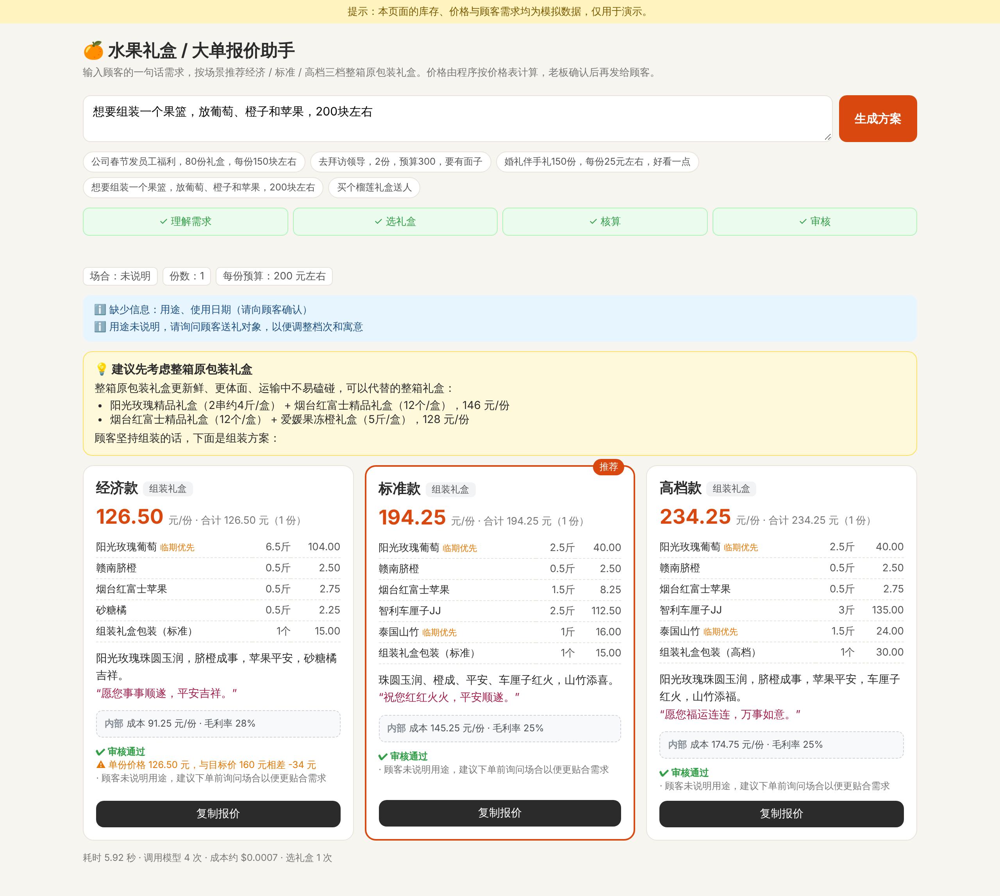
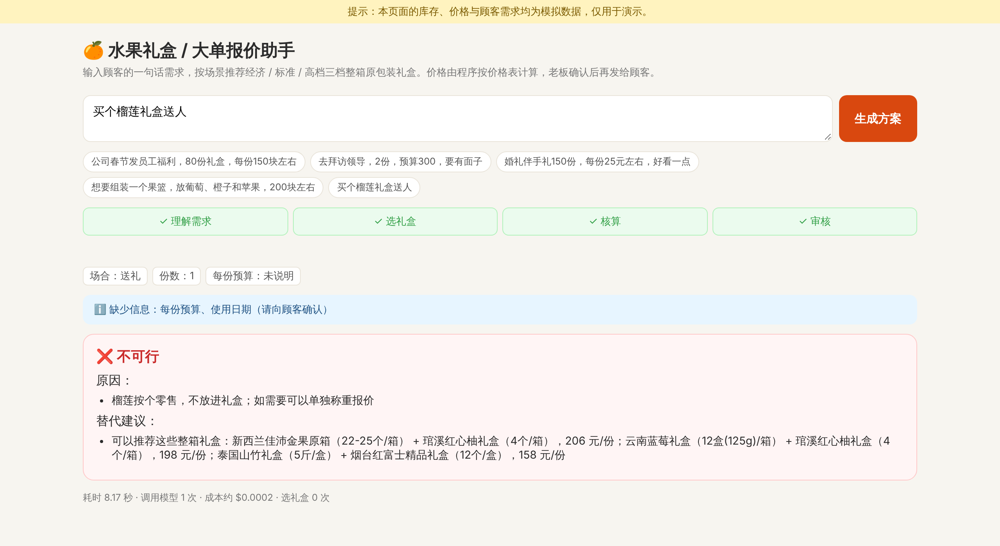

# fruit-gift-quote · 水果礼盒 / 大单报价助手

**🔗 在线体验：<https://fruit-gift-quote.onrender.com>**（免费实例闲置后首次打开需等待约 30–60 秒）

**[📄 产品需求文档（PRD）](PRD.md)**



**一句话介绍**：输入顾客的一句话需求（如"去拜访领导，2 份，预算 300，要有面子"），多个 AI Agent 按场景规则推荐**经济 / 标准 / 高档三档整箱原包装礼盒**，价格、成本、毛利全部由代码按价格表计算，并经过规则 + AI 双重审核，老板确认后一键复制发给顾客。

> ⚠️ 项目中的库存、价格和顾客需求均为**参照真实情况编写的模拟数据**；访谈洞察和场景规则来自真实经营者。

## 为什么做

项目原型来自上海一家水果批发市场里的零售 + 批发档口（家庭经营）。访谈中的关键发现（详见 [PRD.md](PRD.md) 第 1 节）：

- **利润被挤压**：网购、外卖和商超让价格越来越透明，日常零售顾客在流失，周边还有十几家同行。
- **线下优势在大单和送礼**：办酒席、送礼、公司福利的顾客仍愿意到线下亲眼挑货，逢年过节批发占比更高。
- **报价靠人脑和纸笔**：每月价格不同，靠纸笔计算器，出现过记错价、按错计算器的情况。
- **顾客爱讨价还价**，搭配礼盒全凭经验、现场来回调整。
- **易腐水果有损耗**：部分水果放不住，卖不掉就坏。

所以 AI 不去和网店拼价格，而是帮档口**把守得住的大单 / 送礼生意做得更快、更准、更赚钱**。

**v1.1 根据经营者反馈改为以整箱原包装礼盒为主**：档口实际卖的礼盒绝大多数是原包装整箱，现场组装果篮只在顾客明确要求时才做（见下文「踩坑记录」）。

## 功能

- 一句话需求 → 结构化解析（用途、份数、每份预算、日期、忌讳、包装偏好、缺失信息）
- **整箱礼盒优先**：三档 = 三款不同价位的整箱礼盒；必要时「主礼盒 + 伴手礼小盒」或两款整箱组合
- **场景规则表**（[docs/scene_rules.md](docs/scene_rules.md)）写在代码里：按场景的档次倾向、包装风格（大气 / 实在 / 精美）、寓意和忌讳排序推荐
- **组装礼盒只在顾客明确要求时提供**，并先推荐 1–2 款可代替的整箱礼盒、说明原因；组装时每档 3–5 种、单盒 4–8 斤、同种水果不放两个规格，全部由代码校验
- **榴莲不入礼盒**：顾客要榴莲礼盒时说明按个零售、可单独报价，并推荐其他整箱礼盒
- 代码计算单份价格（批发价）、总价、成本、毛利率；毛利率低于 20% 报警
- 每档自动生成方案介绍和祝福语（禁止出现任何数字和价格）
- 程序规则校验 + 审核 Agent 寓意检查，不通过返工 1 次；仍不行就如实说明「不可行」并给替代建议
- 网页：实时进度（理解需求 → 选礼盒 → 核算 → 审核）、三档卡片（手机上竖排）、毛利率标注「内部」、「复制报价」只复制不含成本和毛利的文本
- 评测脚本：24 条测试需求批量跑，输出 PRD 第 7 节指标及 v1.1 新增指标

## 多 Agent 流程



用 LangGraph 编排，代码见 [`app/graph.py`](app/graph.py)。

### 为什么用多 Agent，为什么计算和筛选交给代码

- **职责单一、可单独检查**：每一步的输入输出都记录在 `trace` 里，出错能定位到具体环节。
- **审核节点能拦截错误**：方案到达顾客前，先过程序规则，再过 AI 寓意审核，不通过自动返工。
- **算数交给代码**：大模型做算术不可靠，而报价出错的代价很高。价格、总价、成本、毛利全部由 [`app/pricing.py`](app/pricing.py) 按价格表计算。
- **能用规则筛选的先用代码筛**（v1.1）：忌讳、榴莲、保鲜期、库存、预算区间、场景档次和包装风格都在 [`app/checks.py`](app/checks.py) 里筛选和排序，选礼盒 Agent 只在每档 5 个候选里挑选。这样模型调用少、提示词短，平均约 4 次调用、5 秒左右出结果。
- **程序兜底**：AI 选的标准款不在预算区间（而库存里有在区间内的）时，由代码替换为最匹配的礼盒；三档重复或价格顺序不对时由代码调整；组装礼盒在已选水果内按半斤/一个的步长微调用量。评测里单独统计「AI 原始方案预算符合率」，看 AI 本身做得怎么样。
- **规则写死在代码里**：场景规则表、忌讳表、档次定价、保鲜期门槛、组装规则都在 [`app/rules.py`](app/rules.py)。

## 评测结果

在 24 条测试需求上运行 `eval/run_eval.py` 的结果（完整明细见 [eval/results.md](eval/results.md)）：

| 指标 | 结果 | 目标 |
| --- | --- | --- |
| 报价计算准确率 | 100%（59/59） | 100% |
| 预算符合率（最终方案） | 90%（18/20） | ≥ 90% |
| AI 原始方案预算符合率（程序调整前） | 85%（17/20） | 记录 |
| 库存可行率 | 100%（59/59） | 100% |
| 忌讳违规数 | 0 | 0 |
| 榴莲误入礼盒次数 | 0 | 0 |
| 高档款含普通档商品次数 | 0 | 0 |
| 非回礼场景使用伴手礼小盒次数 | 0 | 0 |
| 推荐标签符合毛利规则 | 100%（20/20） | 100% |
| 不可行需求识别率 | 100%（4/4） | ≥ 90% |
| 可行需求误判为不可行 | 0 | 0 |
| 整箱礼盒优先率（非组装请求） | 100%（19/19） | 100% |
| 场景档次匹配率 | 100%（5/5） | 记录 |
| 包装偏好匹配率 | 75%（3/4） | 记录 |
| 临期商品占比（≤5 天，按金额） | 11.0% | 记录 |
| 需求解析准确率（份数+预算） | 100%（24/24） | 记录 |
| 平均生成耗时 | 4.9 秒 | ≤ 30 秒 |
| 超过 30 秒的比例 | 0%（0/24） | 记录 |
| 平均模型调用次数 | 3.8 | 记录 |
| 平均单次成本 | $0.0005 | 记录 |

说明：

- 报价准确率、库存可行率按"方案档位"统计；评测脚本独立按价格表重算价格，不复用业务代码。
- **预算未达标的 2 条**，都是库存里没有落进预算区间的组合，按店主定的"预算优先，凑不上就选最接近的并提示"处理：
  - T24（婚礼伴手礼 25 元左右）：最便宜的礼盒是 22 元的砂糖橘伴手礼小盒，低于 25 元 ±10% 的下限 22.5 元；标准款给 22 元，经济档没有更便宜的礼盒而空缺。
  - T18（开业 50 份，每份 88 元）：「伴手礼小盒只用于回礼场景」规则生效后，原来的"苹果礼盒 + 砂糖橘小盒 = 90 元"不能再用；其他能落进 79–97 元的组合（凤梨、甜柿、山竹礼盒等）库存都不够 50 份，标准款只能给最接近的阳光玫瑰礼盒 78 元并标注差额。
- 包装偏好未匹配的 1 条是 T03（婚庆回礼，场景默认偏好精美）：选了"烟台红富士精品礼盒（大气）+ 金桔伴手礼小盒（精美）"。场景默认的包装风格只作为排序加分；顾客亲口说的包装偏好（T16 要大气、T23 要有面子、T24 好看一点）会严格遵守。
- 「推荐」标签按毛利规则给：例如拜访领导、商务送礼时，车厘子原箱毛利只有 18%，推荐标签会移到毛利达标的一档，并在页面上给店主一条（内部）提示。
- 24 条跑一遍约 $0.012。模型输出有随机性，多次运行结果会有小幅波动。

## 本地运行

需要 Python 3.10+ 和一个 [OpenRouter](https://openrouter.ai) API 密钥。

```bash
pip install -r requirements.txt
```

```bash
cp .env.example .env   # 然后在 .env 里填入 OPENROUTER_API_KEY
```

```bash
uvicorn app.main:app --port 8000
```

浏览器打开 http://localhost:8000 。运行评测：

```bash
python eval/run_eval.py --workers 4
```

环境变量：

| 变量 | 说明 | 默认 |
| --- | --- | --- |
| `OPENROUTER_API_KEY` | OpenRouter 密钥（**只放环境变量 / .env，不要提交**） | 无 |
| `OPENROUTER_MODEL` | 模型名 | `deepseek/deepseek-v4.1-flash-1017` |
| `MAX_COST_USD` | 单个进程累计调用费用上限，超过即拒绝调用 | `0.5` |

**默认模型**：`deepseek/deepseek-v4.1-flash-1017`（DeepSeek V4.1 Flash 的 2026-10-17 固定快照）。中文好、支持 JSON 输出、价格很低；用固定快照，评测结果更可复现。所有 Agent 都关闭推理模式（候选已由代码筛好，不需要模型长时间推理），单次调用约 1–3 秒。

## 部署到 Render（免费版）

仓库根目录的 [`render.yaml`](render.yaml) 是 Render Blueprint 配置：Python Web Service、免费实例、健康检查 `/api/health`，`MAX_COST_USD=1`。**OpenRouter 密钥不写进仓库**，只在 Render 网页上填写（`sync: false`）。

1. 登录 [Render](https://render.com)，用 GitHub 账号授权，并允许 Render 访问本仓库。
2. 点 **New → Blueprint**，选择本仓库，分支选 `main`。
3. Render 读取 `render.yaml` 后，会要求填写 `OPENROUTER_API_KEY`：粘贴你的 OpenRouter 密钥，点 **Apply / Deploy**。
4. 等待构建完成（几分钟），打开 Render 给的 `https://<服务名>.onrender.com` 地址即可使用（本项目的线上地址：<https://fruit-gift-quote.onrender.com>）。

注意：

- 免费实例闲置一段时间后会休眠，下次访问要等几十秒唤醒。
- `MAX_COST_USD` 是**单个进程**的累计上限，实例休眠重启后会重新计数。要设真正的总额上限，请在 OpenRouter 后台给这个密钥设置额度（Credit limit）。
- 部署后的网址是公开的，任何人都能调用、消耗你的额度；建议只给需要的人，并设好上面的额度。

## 数据说明

- [`data/inventory.csv`](data/inventory.csv)：20 款整箱礼盒（type=整箱礼盒，含规格、档次 grade、包装风格 packaging_style）、12 种散装水果（只用于组装礼盒）、2 种组装包装。**模拟数据**。
- [`data/test_cases.json`](data/test_cases.json)：24 条测试需求及期望结果（含 expect_type / expect_grade / expect_packaging）。**模拟数据**。
- [`docs/scene_rules.md`](docs/scene_rules.md)：经营者访谈整理的场景规则表（v1.1）。
- 报价按**批发价**计算，成本按成本价计算。

## 产品决策

| 决策 | 做法 | 原因 |
| --- | --- | --- |
| **整箱优先** | 三档 = 三款不同价位的整箱原包装礼盒；每档以一款为主，必要时（回礼场景）「主礼盒 + 伴手礼小盒」 | 档口实际以整箱礼盒为主；原包装更新鲜、更体面、不易磕碰，也省去现场组装的时间 |
| 整箱组合 | 一款凑不进预算时，允许两款不同整箱礼盒组合（每份最多 2 款）；只在没有单款/主+小礼盒落进区间时才用 | 礼盒价格是离散的（22…368 元），只用单款很多预算凑不上（店主确认） |
| **组装需明确要求** | 只有顾客说"组装 / 混装 / 自己搭配"才提供；先推荐 1–2 款可代替的整箱礼盒并说明原因 | 经营者不推荐组装：费时、易磕碰、不如原包装体面 |
| 组装规则 | 每档 3–5 种、单盒 4–8 斤、同一种水果不放两个规格，代码校验 | v1 出现过 10 种水果、12 斤一盒这样不合理的方案 |
| **榴莲不入礼盒** | 榴莲（F08）永远不进礼盒；要榴莲礼盒时说明按个零售、可单独称重报价，并推荐其他整箱礼盒 | 榴莲按个卖、气味重，经营者不把它放进礼盒 |
| **场景规则表** | 场景 → 档次倾向、价值、包装风格、忌讳、寓意好的商品，写在 `app/rules.py`，按场景和顾客包装偏好排序 | 规则来自经营者经验，写成代码可校验、可评测，不只依赖模型 |
| 包装偏好 | 顾客说"大气/有面子/上档次"→ 大气；"实在/量多/划算"→ 实在；"好看/精致"→ 精美。顾客亲口说的：预算区间内有匹配风格的礼盒时，标准款只在这些里选；场景默认风格只作排序加分 | 同上；顾客明说的要求要遵守 |
| 档次 vs 预算 | 预算优先：场景档次作为排序加分；预算内够不上该场景档次时，提示"预算提高到约 X 元可选 Y" | 店主确认：不替顾客做超预算的决定 |
| **高档款只用精品/高档** | 高档款里所有商品的档次都必须是精品或高档，不能搭配普通档的小盒；没有合规组合时该档空缺并说明 | 高档款是给顾客"有面子"的选项，搭一盒普通砂糖橘会拉低档次感（店主确认） |
| **伴手礼小盒只用于回礼** | 砂糖橘、金桔伴手礼小盒只用于婚庆、满月等回礼场景；其他场景不进候选（顾客点名要的除外） | 小盒是回礼用的，送领导、探病、公司福利搭小盒不合适（店主确认） |
| **推荐标签看毛利** | 默认推荐标准款（顾客要高档时推荐高档款），但优先给毛利率 ≥ 20% 的方案；三档都低于 20% 时推荐毛利率最高的一档，并在页面上提示店主 | 推荐是店主引导成交的方向，应优先保住利润底线（店主确认） |
| 预算措辞 | "预算 X"没有"左右"等修饰词时按上限处理；"左右"按 ±10%；"以内/不超过"时标准款为预算的 90%–100% | 尊重顾客的上限（店主确认） |
| 三档定价 | 经济 0.8× / 标准 1.0× / 高档 1.3× 预算；凑不上时空缺该档并说明 | 让顾客"选方案"而不是"砍单价"（店主确认） |
| 没给预算 | 按 100 / 200 / 300 元出三档，优先库存久、需尽快卖掉的礼盒；顾客明显要高档时推荐高档款 | 先给方案再确认（店主确认） |
| 保鲜期 | 剩余保鲜 ≥ 距使用日 + 2 天；没说日期按 ≥ 3 天 | 送到后至少还能放两天（店主确认） |
| 忌讳 | 探病、婚庆、乔迁不用梨（G14、F13）；顾客点名不要的不用；"梨"不误伤"凤梨" | 规则表 + 代码核对 |
| 健康相关需求 | 顾客提到糖尿病/控糖等时，高糖水果直接不进候选，并提示"仅供参考，不构成医疗建议" | 不做医疗建议 |
| **30 秒目标** | 代码先筛、模型只挑；所有 Agent 关闭推理；返工从 2 次降为 1 次；网页实时显示进度 | 顾客站在档口前等不了一两分钟；v1 大单要 1–2 分钟 |
| 毛利率 | 只给店主看（标注「内部」），复制给顾客的文本不含成本和毛利；低于 20% 报警，并影响「推荐」标签 | 保护利润底线（车厘子原箱毛利约 18%，会提示） |
| 人工确认 | AI 不直接对外报价，老板确认后复制发送 | 报价出错代价高 |

表外场景的处理：满月回礼参照婚庆伴手礼（但不受"不送梨"限制），节日慰问、孝敬长辈参照节日送礼，公司活动参照公司福利。

## 踩坑记录

1. **"别放梨"误伤凤梨**：需求理解 Agent 把"别放梨"解析成同时排除皇冠梨和金钻凤梨。解决：用商品俗称表在代码里核对模型输出，"梨"只对应梨（匹配前先去掉"凤梨"二字），模型多排除的、原话里没提到的商品一律去掉。
2. **推理 token 用完，返回空内容**：模型开了推理模式时，推理过程把 `max_tokens` 用光，正文是空的，整条需求报错，网页卡住。解决：空内容自动重试（关推理、加大上限）；v1.1 先只给选礼盒 Agent 开推理，但评测发现它偶尔推理很久又返回空内容，一条需求要 2 分钟；候选既然已由代码筛好，最后所有 Agent 都关闭推理，平均耗时从 15 秒降到 5 秒，质量指标没有下降。
3. **指标全部达标，方案却不合理**：v1 在 20 条用例上全部指标达标，但人工检查发现方案并不合理：组装礼盒里放榴莲、一盒十几斤、一盒放七到十种水果。和经营者访谈后发现根本原因是**对业务理解有误**：档口实际以**整箱原包装礼盒**为主，组装是少数情况，榴莲根本不做礼盒。于是 v1.1 改了数据模型（新增 type / spec / grade / packaging_style），把场景规则写成代码，并补充了评测维度（整箱优先率、场景档次匹配率、包装偏好匹配率、榴莲误入次数、AI 原始方案预算符合率、超过 30 秒的比例）。教训：**评测指标只能检查你想到的东西**，指标之外要人工看方案、回到业务现场确认。
4. （v1.1 调试中）**审核 Agent 越权**：审核 Agent 会以"经济款档次不够"为由打回商务送礼方案，但档次是店主定的"预算优先"规则决定的；它还把库存表寓意备注里的"（适合婚庆伴手礼）"当成文案，判定探病方案不合适。解决：在提示词里明确审核范围只有寓意和文案，给模型看寓意时去掉括号里的场合备注。

## 迭代计划

PRD 第 9 节及 v1.1 补充：

| 优先级 | 计划 |
| --- | --- |
| P1 | 拍照识别今日到货，自动更新库存 |
| P1 | 生成可发朋友圈的方案图片 |
| P2 | 记录每次报价与成交结果，统计成交率和客单价 |
| P2 | 根据历史成交和保鲜期给出进货建议 |
| P2 | "同场景顾客常选"推荐（不显示价格和顾客信息）：需要真实成交记录，等记录成交数据后再做 |
| P3 | 对接微信，顾客直接从朋友圈进入下单 |
| P3 | 多位顾客同时下单时的库存占用，以及库存不够时向隔壁档口借调：范围复杂，第一版暂不做 |

本版本已知不足：

- 库存只按单笔订单校验（同上 P3）。
- 包装偏好是排序加分，不是硬规则，偶尔会选到风格不完全一致的礼盒（评测 75%）。
- 组装礼盒的经济款在重量和种类限制下可能离目标价较远（会标注差额）。
- 库存与价格需手动改 CSV（见 P1）。

## 截图

| 实时进度 | 拜访领导（桌面） | 婚礼伴手礼 150 份（手机） |
| --- | --- | --- |
|  |  |  |

| 组装请求：先推荐整箱 | 榴莲礼盒：不入礼盒 |
| --- | --- |
|  |  |

## 项目结构

```
app/
  main.py        FastAPI 服务（网页 + /api/quote + /api/quote/stream 实时进度）
  graph.py       LangGraph 多 Agent 编排
  agents.py      LLM Agent 的提示词（需求理解、选礼盒、文案、审核）
  checks.py      候选生成与排序、不可行预检、组装用量微调、规则校验
  rules.py       场景规则表、忌讳、档次定价、保鲜期、组装规则
  pricing.py     报价核算（纯代码）
  llm.py         OpenRouter 调用、token/费用统计、费用上限
  inventory.py   库存表读取
static/index.html  单页网页
eval/run_eval.py   评测脚本；eval/results.md 评测结果
data/              模拟数据
docs/              场景规则表、网页截图、演示动图
render.yaml        Render 部署配置
```
